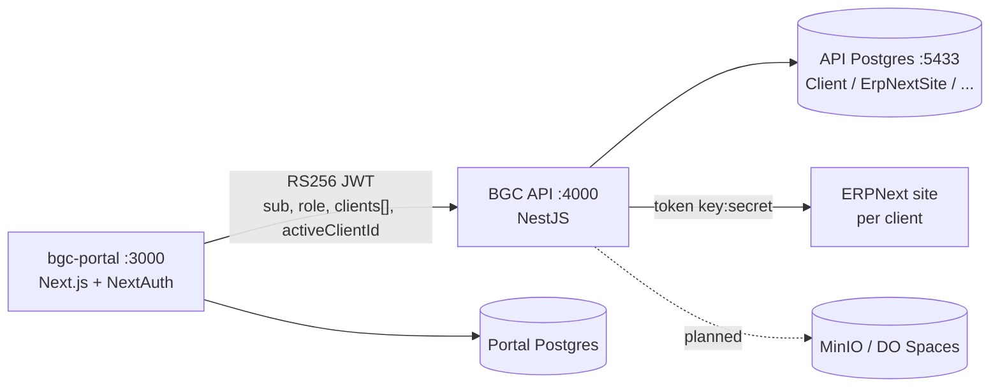

# BGC API

Multi-tenant backend for the BGC Tax Preparers platform. Verifies session JWTs issued by the **bgc-portal** (Next.js), enforces tenant-scoped access against its own Postgres registry, and brokers calls to per-client **ERPNext** sites.

**Stack:** NestJS 11 · Prisma 6 · PostgreSQL · RS256 JWT · AES-256-GCM credential sealing · (planned: DO Spaces/MinIO, BullMQ, ClamAV)

---

## Quick Start

### 0. Prerequisites

- Node.js ≥ 20 (22 recommended)
- Docker (running the shared dev stack: Postgres `:5433`, Redis `:6379`, MinIO `:9000`, ClamAV `:3310`)
- A reachable ERPNext dev site (e.g. `http://bgc-dev.localhost`)
- A portal-issued session JWT for testing

The API expects the dev stack from the root `docker-compose.yml` — it does **not** ship its own; use the existing project compose.

### 1. Install &amp; configure

```bash
npm install
cp .env.example .env
```

Fill in (all required — the app and seed fail fast on missing config):


| Variable                               | Purpose                                        | How to get it                                                                   |
| -------------------------------------- | ---------------------------------------------- | ------------------------------------------------------------------------------- |
| `DATABASE_URL`                         | API's own Postgres                             | Already matches the compose stack (`localhost:5433`)                            |
| `JWT_PUBLIC_KEY`                       | Verify portal-issued RS256 tokens              | The portal's **public** key (pair of its signing key). `\n`-escaped PEM is fine |
| `JWT_ISSUER` / `JWT_AUDIENCE`          | Token claim checks                             | `bgc-portal` / `bgc-api` unless the portal differs                              |
| `ENCRYPTION_KEY`                       | AES-256-GCM key for ERPNext credentials        | `openssl rand -hex 32` — exactly 64 hex chars                                   |
| `SEED_CLIENT_ADMIN_USER_ID`            | Portal user id (= JWT `sub`) to mirror for FKs | `SELECT id FROM "User"` in the **portal** DB, or decode a real token            |
| `SEED_STAFF_USER_ID`                   | Optional staff mirror                          | Same as above, staff/admin portal user                                          |
| `ERPNEXT_SEED_API_KEY` / `_API_SECRET` | ERPNext API credentials to seal                | ERPNext → My Settings → API Keys → Generate                                     |
| `ERPNEXT_SEED_SITE_URL`                | Dev ERPNext site                               | e.g. `http://bgc-dev.localhost`                                                 |
| `DO_SPACES_*`                          | Storage (presigning, next phase)               | MinIO locally: endpoint `http://localhost:9000`, key/secret from compose        |


### 2. Migrate &amp; seed

```bash
npx prisma migrate dev --name init   # applies schema AND auto-runs the seed
```

Seed is idempotent (upserts keyed by natural ids) — re-run freely with `npm run seed`.

### 3. Run &amp; smoke-test

```bash
npm run dev    # :4000, watch mode
```

```bash
curl http://localhost:4000/v1/health                                     # public liveness
curl -H "Authorization: Bearer $TOKEN" http://localhost:4000/v1/auth/session   # token OK? claims?
curl -H "Authorization: Bearer $TOKEN" http://localhost:4000/v1/clients/company-a/erpnext-link/health  # full chain
curl -H "Authorization: Bearer $TOKEN" http://localhost:4000/v1/clients/company-b/erpnext-link/health    # → 404 by design
```

---

## Scripts


| Command                       | Purpose                |
| ----------------------------- | ---------------------- |
| `npm run dev`                 | NestJS in watch mode   |
| `npm run build` / `npm start` | Production build / run |
| `npm run typecheck`           | `tsc --noEmit`         |
| `npm run seed`                | Idempotent dev seed    |
| `npm run prisma:migrate`      | `prisma migrate dev`   |
| `npm run prisma:studio`       | Prisma Studio          |


---

## Architecture



**Two databases by design.** The portal owns users/auth; the API owns its tenant registry and mirrors portal user **ids only** where FKs need them (`Document.uploader`, `TaxReturn.preparedBy`). The join key is the user id carried in the JWT `sub` — portal user ids are never invented here.

### Request lifecycle

1. **JwtAuthGuard** (`src/common/auth/`) — verifies RS256 signature, issuer, audience; maps claims to `req.user`; enforces `@Roles(...)` gates
2. **TenantGuard** (`src/common/tenancy/`) — resolves the URL `:clientId` (a **slug**) to a `Client` row; checks membership for client roles (staff bypass); writes `req.tenant` with the resolved uuid; enforces status (suspended blocks writes with 409, cancelled → 404)
3. **Controller/Service** — receives typed `TenantContext` + `SessionUser`; services query by `req.tenant.clientId` (uuid), never by slug

### Module map


| Path                       | Responsibility                                                                  |
| -------------------------- | ------------------------------------------------------------------------------- |
| `src/common/prisma/`       | Global `PrismaService`                                                          |
| `src/common/auth/`         | JWT guard, `@Roles`, `@CurrentUser`, session types                              |
| `src/common/tenancy/`      | `TenantGuard`                                                                   |
| `src/modules/health/`      | Public liveness                                                                 |
| `src/modules/auth/`        | `GET /v1/auth/session` (introspection)                                          |
| `src/modules/clients/`     | Tenant-scoped client info                                                       |
| `src/modules/erpnext/`     | Credential sealing (`credentials.crypto.ts`), ERPNext REST client, health check |
| `src/modules/documents/`   | Upload presign (presign stubbed pending Spaces wiring)                          |
| `src/modules/tax-returns/` | Presign/finalize/list/download (staff-gated writes)                             |


### Data model (essentials)

- **Client** — tenant registry; `slug` is the public identifier, `status` gates access
- **ErpNextSite** — 1:1 with Client; **the only** source of ERPNext connection info; key/secret sealed with AES-256-GCM
- **User** — mirror of portal users (same ids); exists only for FK integrity
- **ClientUser** — membership join
- **Document / TaxReturn** — storage keys follow `{slug}/{uploads|returns}/{taxYear}/{uuid}-{filename}`
- **AuditLog** — access trail (downloads, later all writes)
- **ProvisioningJob** — future ERPNext site provisioning state machine

---

## Conventions (locked in — do not diverge)

1. **Roles are UPPERCASE strings everywhere**: JWT claims, guards, decorators, Prisma enum. No mapping layers.
2. **URLs carry client SLUGS; DB queries use the resolved UUID.** Slug → uuid happens only in `TenantGuard`.
3. **Anti-enumeration**: any unauthorized or nonexistent tenant → identical `404`. Never 403 for tenancy failures (403 only for role gates).
4. **One source of truth per fact**: ERPNext connection info lives only in `ErpNextSite`; the user identity lives only in the portal.
5. **Fail fast on config**: missing `JWT_PUBLIC_KEY`/`ENCRYPTION_KEY` aborts boot/seed loudly.
6. **Suspended clients**: reads pass, writes get `409 CLIENT_SUSPENDED`.
7. Never trust `req.body.clientId` over the URL param; the guard treats them consistently but URL slugs are canonical.

---

## Security notes

- ERPNext API secrets sealed at rest (AES-256-GCM, `base64(iv|tag|data)`)
- JWT verification: RS256 only, pinned issuer + audience, no algorithm confusion
- Helmet enabled globally; validation pipe whitelists DTOs (`forbidNonWhitelisted`)
- Anti-enumeration 404s on all tenant lookups
- Planned: pre-signed URLs only (no file bytes through the API), audit logging on every write, ClamAV scan before processing

---

## Roadmap

- [ ] SpacesService: real presigned PUT/GET against MinIO (replace stubs in documents/tax-returns)
- [ ] Confirm-upload endpoint + `pending_upload → uploaded` transition
- [ ] ERPNext reads/writes beyond ping (Customer, Invoice)
- [ ] Staff provisioning flow (portal → API user sync)
- [ ] BullMQ workers (Redis) + ClamAV virus scan
- [ ] TaxAct PDF ingestion pipeline
- [ ] MFA enforcement phase, audit on all writes

---

## Troubleshooting


| Symptom                              | Cause                                    | Fix                                                                           |
| ------------------------------------ | ---------------------------------------- | ----------------------------------------------------------------------------- |
| Seed: `Missing required env var: X`  | `.env` incomplete                        | Set the var — the message names it                                            |
| Seed: `P2021 table does not exist`   | Migration not applied                    | `npx prisma migrate dev`                                                      |
| Seed: `P2002` on User id             | Two seed ids identical, or stale row     | Ids must be distinct **portal** ids; `DELETE FROM "User"` then re-seed        |
| Drift detected on migrate            | DB carries history from an older project | `npx prisma migrate reset --force` (dev DB only!)                             |
| Boot: `JWT_PUBLIC_KEY is not set`    | Guard fail-fast                          | Put the portal's public key in `.env`                                         |
| `ENCRYPTION_KEY must be 32-byte hex` | Wrong format                             | `openssl rand -hex 32`, no quotes/prefix                                      |
| Health 503 `ERPNEXT_UNREACHABLE`     | API can't reach ERPNext site / bad creds | Check site URL resolves from API host; check `ErpNextSite.healthError` column |
| Health 404 `ERPNEXT_NOT_CONFIGURED`  | No ErpNextSite row for the client        | Run seed with ERPNext vars set                                                |
| 401 on all requests                  | Signature/issuer/audience mismatch       | Compare portal's key and `iss`/`aud` claims with API env                      |


> ⚠️ `prisma migrate reset` drops data. Only ever run it against the API's **dev** database on `:5433` — never against the portal DB.

---

## Environment matrix


| Variable                                       | Required at     | Notes                            |
| ---------------------------------------------- | --------------- | -------------------------------- |
| `PORT`                                         | boot            | default 4000                     |
| `DATABASE_URL`                                 | boot + seed     |                                  |
| `JWT_PUBLIC_KEY`, `JWT_ISSUER`, `JWT_AUDIENCE` | boot            | guard fail-fast                  |
| `ENCRYPTION_KEY`                               | boot + seed     | 64-char hex                      |
| `SEED_CLIENT_ADMIN_USER_ID`                    | seed            | portal user id                   |
| `SEED_STAFF_USER_ID`                           | seed (optional) | portal staff id                  |
| `ERPNEXT_SEED_*`                               | seed            | sealed into ErpNextSite          |
| `DO_SPACES_*`                                  | next phase      | MinIO locally, DO Spaces in prod |